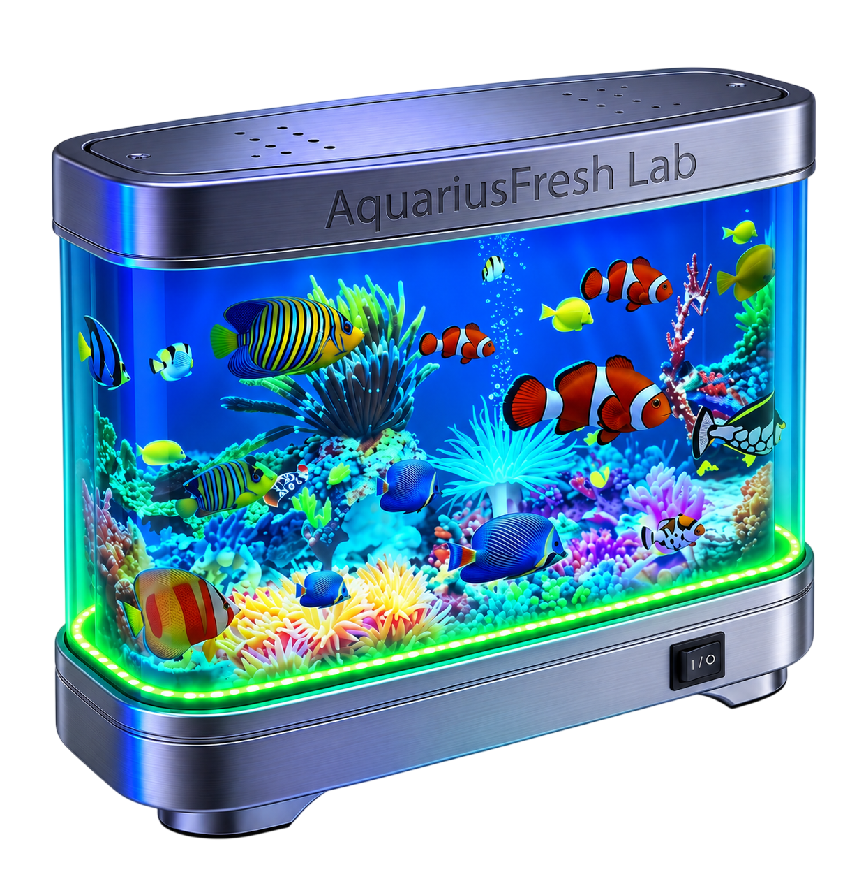

  

<h1 align="center">AquariusFresh Lab</h1>

  <strong>Independent Software Studio</strong>

An independent initiative focused on developing creative software, digital experiences and applications.

AquariusFresh Lab was conceived with the intention of becoming an independent software company, bringing together technology, creativity and distinctive digital identities.

## Our First Product

### FoldAero

Our first planned software product, marking the beginning of the AquariusFresh Lab ecosystem.

## Institutional Information

- **Founder:** Pedro Paulo de Lima (a.k.a. eclipse.exe)
- **Founded as an initiative:** 2026
- **Current status:** Pre-foundation / Independent project
- **Main activity:** Software development
- **First product:** FoldAero

## Official Documentation

[Read the Declaration of Intent (PDF)](https://github.com/AquariusFresh-Lab/institutional-documents/blob/main/AquariusFresh-Lab-Declaration-of-Intent-2026.pdf)

---

*AquariusFresh Lab is currently an independent project in development and has not yet been formally incorporated as a legal entity.*